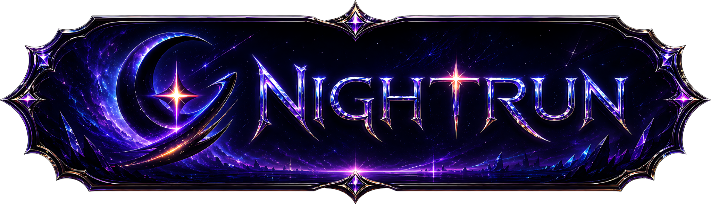
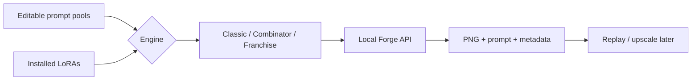

<p align="center">
  
</p>

<p align="center">
  <strong>Let Forge render overnight. You can go do literally anything else.</strong>
</p>

<p align="center">
  <a href="https://github.com/Bluenochian/Nightrun/releases/tag/v2.2"><strong>Windows — Nightrun 2.2</strong></a> ·
  <a href="https://github.com/Bluenochian/Nightrun/releases/tag/linux-native"><strong>Linux Native</strong></a> ·
  <a href="#getting-started">Getting started</a> ·
  <a href="#what-to-edit">What to edit</a> ·
  <a href="#troubleshooting">Help</a>
</p>

---

## What is Nightrun?

I wanted to leave Stable Diffusion Forge generating images overnight. Seemed easy enough. Turns out choosing decent prompts, resolving LoRAs, keeping an eye on VRAM, and saving usable metadata can become its own full-time job.

So I made Nightrun.

It builds prompts from editable text pools, passes them through Classic / Combinator / Franchise engines, talks to **your local Forge / Forge-Neo API**, and saves the result along with its choices. It can upscale from metadata later, take cooling breaks, and stop after the current image. No cloud account, no mystery hosted image service.

The entire point is to spend *less* time babysitting the computer. Let's try not to defeat that purpose.

## Choose your edition

| | **Windows** | **Linux Native** |
| --- | --- | --- |
| **Download** | [Nightrun 2.2](https://github.com/Bluenochian/Nightrun/releases/tag/v2.2) | [Linux Native](https://github.com/Bluenochian/Nightrun/releases/tag/linux-native) |
| **Installation** | Extract two folders below the Forge root | Run the per-user installer; no sudo or fixed Forge folder |
| **Launch** | Included `.bat` files | `nightrun-linux` command or KDE/GNOME menu |
| **Configuration** | `config.local.json` in the Nightrun folder | `~/.config/nightrun-linux/config.local.json` |
| **Full instructions** | [Windows setup and editing guide](docs/WINDOWS_GUIDE.md) | [Linux setup and editing guide](linux-native/GUIDE.md) |

**Two editions, two straightforward ways to install.** The Windows download uses the familiar batch launchers. Linux Native installs into your user account, adds desktop-menu entries, and keeps your personal settings separate from the application.

## Getting started

### Windows

Download [2.2](https://github.com/Bluenochian/Nightrun/releases/tag/v2.2) and extract it like this:

```text
YourForgeFolder/
├── venv/
└── workflows/
    └── nightrun_2.2/
        ├── config.json
        ├── nightrun.py
        ├── modules/
        ├── pools/
        └── Run First Setup.bat
```

The two-folder depth matters because the launchers look for Forge's `venv/Scripts/python.exe` by going up two directories. Run **First Setup**, then **Validation**, then **One DRY TEST**, and finally the **BASE** launcher. Don't go straight to a 300-image batch. I know it's tempting.

[Windows walkthrough, including config and LoRA editing](docs/WINDOWS_GUIDE.md)

### Linux

Download [Linux Native](https://github.com/Bluenochian/Nightrun/releases/tag/linux-native). It doesn't go inside Forge.

```bash
tar -xzf nightrun-linux-native.tar.gz
cd nightrun-linux
bash install.sh

~/.local/bin/nightrun-linux setup --repo "/path/to/your/Forge"
~/.local/bin/nightrun-linux validate --count 100
~/.local/bin/nightrun-linux dry-run --count 5
~/.local/bin/nightrun-linux base --count 1
```

The installer uses your user account, an isolated Python venv, XDG directories, and real Linux desktop entries. The app can then be launched from the KDE/GNOME menu.

[Linux walkthrough, including custom pools and safe upgrades](linux-native/GUIDE.md)

## How it works



Classic mixes your normal prompt fragments. Combinator adds structured variations. Franchise keeps the selected characters, outfits, environments and props in one coherent world instead of turning everything into a crossover accident.

LoRA names are resolved from local files and aliases. Some fuzzy matches are skipped if they're ambiguous. Better a skipped LoRA than quietly loading the wrong one.

Your installed checkpoints, LoRAs, extensions and Forge setup remain your responsibility. They're not shipped in the download.

## What to edit

Start with **your own local config**, not the Python source. Unless you actually want to maintain the engine. In which case, condolences.

| Want to change | Find this setting |
| --- | --- |
| How many images | `count` |
| Which checkpoint | `checkpoint` |
| Base dimensions and steps | `base.width`, `base.height`, `base.steps_min`, `base.steps_max` |
| Upscaling on/off | `upscale.enabled` |
| Cooling pauses | `temperature.pause_above_c`, `temperature.resume_below_c` |
| Engine mix | `prompt_engines.weights` |
| LoRA names and aliases | `always_loras`, `random_loras`, `lora_scan.aliases` |
| How often a pool appears | Its `chance` inside `prompt_pools` |

The text in `pools/*.txt` is editable too: one candidate prompt fragment per line. **Keep personal copies** before replacing the application folder. Linux users should keep custom pools under `~/.config/nightrun-linux/pools/` and reference them by absolute path in the config, so upgrades don't wipe them.

The [Linux guide](linux-native/GUIDE.md#4-what-you-can-actually-edit) and [Windows guide](docs/WINDOWS_GUIDE.md#3-what-to-edit-and-what-to-leave-alone) show real examples, including how to disable the `sensual_layer` pool, change prompt-engine weights, and avoid a broken JSON file.

## Running, stopping and recovering

- **Validate:** check configured pools, aliases and prompt construction without generating images.
- **Dry-run:** create example prompts and metadata without sending renders to Forge.
- **Base:** create images. A low-step upscale can still happen if configured.
- **Full:** create images with scheduled upscaling.
- **Stop After Current Image:** finish the current render and exit before starting another one.
- **Metadata upscaler:** replay or upscale an old render from its saved `*_metadata.json`.

Run folders normally contain PNGs, `*_metadata.json`, prompt text, `run.log` and `summary.json`. Read the summary if something failed; it distinguishes successful, partial, failed and stopped batches.

## Troubleshooting

| Problem | First thing to look at |
| --- | --- |
| Python/venv missing | Windows folder depth or Linux Python `venv` installation |
| Checkpoint not found | Forge `models/Stable-diffusion` and configured filename |
| LoRA skipped | Filename, `lora_scan.folders`, and aliases |
| Forge API unreachable | Forge startup logs, `launch.py --api`, and localhost port 7860 |
| Out of VRAM | Image dimensions, LoRA stack size, sampling/upscale settings |
| Metadata upscaling fails | Source JSON, installed upscale extension, and chosen checkpoint |
| Strange prompts | Edit the offending pool, or adjust engine and pool chances |

If you want the long version with commands and screenshots-free explanations, use the guides above. **Please run a one-image test before leaving anything rendering unattended.** A passing offline test is not the same as a successful night with your specific GPU and Forge installation.

## Downloads and source

- [Windows 2.2](https://github.com/Bluenochian/Nightrun/releases/tag/v2.2)
- [Linux Native](https://github.com/Bluenochian/Nightrun/releases/tag/linux-native)
- [Earlier 2.0](https://github.com/Bluenochian/Nightrun/releases/tag/release2) and [1.5](https://github.com/Bluenochian/Nightrun/releases/tag/release) for people already using them
- [Linux Native source and installer](linux-native/) · [Windows guide](docs/WINDOWS_GUIDE.md)

The separate [3.0 dashboard prototype](nightrun_web.py) currently **simulates** progress rather than driving actual image generation. Don't leave that one open overnight expecting 300 pictures. Seriously.

---

<p align="center"><strong>🌙 Let the PC do the babysitting.</strong></p>
